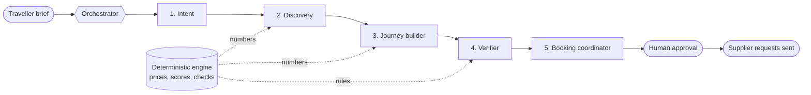

<div align="center">

# WAYFARER

### Tell us the trip. Agents do the booking work.

A multi-agent travel desk for East African safaris, built on Next.js 16 and the Vercel AI SDK 7.

    


<sub>Photo: DEMOSH, via <a href="https://commons.wikimedia.org/wiki/File:Wildebeests_in_the_Masaai_Mara.jpg">Wikimedia Commons</a>, Creative Commons licence (see file page)</sub>

</div>

---

## The idea in one minute

Planning a safari is a small project nobody asked for. You compare lodges across three websites, wonder whether a package is good value or just well marketed, work out how long it takes to get from one park to the next, and email several operators who all reply on different days.

**WAYFARER turns that into one conversation.** A traveller writes a few sentences and a budget. A team of five AI agents reads the brief, shortlists destinations, builds an assembled trip and a package alternative for each, checks the numbers and the logic, and drafts the supplier requests. A person approves anything that involves money.

The design rule that makes it trustworthy:

> **The language model decides and explains. Software does the arithmetic. People approve the payments.**

No number you see on screen was written by a language model. Prices, scores and budget checks come from a deterministic, tested engine, and every price carries an **Estimated** label until a supplier confirms it.

## Why East Africa, why now

| Signal | What the research found (desk research, November 2026) |
|---|---|
| Growing region | Africa received about 81 million international arrivals in 2025, up 8%, the fastest-growing region according to UN Tourism. |
| A big first market | Kenya received about 2.7 million international visitors in 2025. The United States is its largest single source market, at roughly 300,000 arrivals (reports vary slightly). |
| Documented margins | Agent commissions on East African safaris are commonly 10 to 20% of retail, with higher tiers at higher volumes. |
| A costly sales process | Operators on large marketplaces typically need five to six quote requests to win one booking, and spend 5 to 10% of booking revenue on marketing. |
| Real pain | Multi-lodge trips mean coordinating lodges, park fees, guides and internal flights across suppliers, with little way to judge value. |

WAYFARER earns by taking the agent's commission on completed bookings, not by charging for planning. Recommendations never use commission as an input.

## Meet the agents



| # | Agent | What it does | What it may not do |
|---|---|---|---|
| 1 | **Intent** | Turns free text and form fields into a validated trip brief. | Invent a budget or dates. |
| 2 | **Discovery** | Shortlists up to three destinations using a ranking tool. | Override the engine's scores without a stated reason from your interests. |
| 3 | **Journey builder** | Explains each priced option in a sentence or two. | Write any figure. Prices come from code. |
| 4 | **Verifier** | Runs budget and logistics checks, and flags unsupported claims in the narrative. | Pass an option that fails a rule. The checks are deterministic and authoritative. |
| 5 | **Booking coordinator** | Drafts a quote-request email per supplier role for the recommended trip. | Send, pay for or confirm anything. |

Each agent is a `ToolLoopAgent` with a strict output schema (Zod). If a language-model step fails, that step falls back to a rules version, the activity panel says so, and the run continues. With no API key at all, the whole pipeline runs in **rules mode**, clearly labelled.

## A run, step by step

Try the default brief: *"First safari for two in December. Big wildlife, comfortable lodges, no logistics to manage. Open to any country in East Africa."* with a $9,000 budget, two travellers and eight nights.

1. **Intent** extracts the month, interests and priority into a validated brief.
2. **Discovery** ranks Kenya, Tanzania and Rwanda for your priority (lowest cost, least travel time, or most flexibility).
3. **Journey builder** prices each destination twice, as an assembled trip and as a package. For example, Kenya assembled comes to **$8,000** and Tanzania's package to **$8,650** on the demo rates.
4. **Verifier** checks each option: over budget fails, thin headroom and long transfers are noted, and **every option is flagged "no supplier confirmation yet"**.
5. **Booking coordinator** drafts quote requests for the recommended trip, such as "Mara camp" and "Safari vehicle and guide". Nothing is sent.
6. You press **Request this trip**. The request is saved, and a person verifies suppliers before anything is bought.

## Honest status: what is real and what is not

| Area | Status |
|---|---|
| Five-agent pipeline with tool loops and schema-checked output | **Real**, runs against the Claude API |
| Pricing, scoring and verification engine | **Real**, unit tested |
| Streaming agent-activity UI | **Real** |
| Request capture and storage | **Real** (stores to Upstash Redis when configured, otherwise logs) |
| Input validation and a best-effort rate limit | **Real** |
| Supplier rates, seasons and availability | **Placeholder.** Every figure in `lib/data.ts` is demonstration data |
| Supplier emails | **Drafted only.** There is no sending |
| Human approval console | **Not built yet** |
| Payments, ticketing and licences | **Not built.** Required before taking money |

## Quick start

You need Node 20 or newer and an Anthropic API key.

```bash
git clone https://github.com/YOUR-USERNAME/wayfarer.git
cd wayfarer
npm install
npm run test          # engine tests, nine checks
cp .env.example .env.local   # on Windows: copy .env.example .env.local
# put your key in .env.local, then:
npm run dev           # http://localhost:3000
```

Open the app, go to **Plan a trip**, and run the agents. The badge in the activity panel tells you whether the language-model agents are on.

### Settings

| Variable | Required | Purpose |
|---|---|---|
| `ANTHROPIC_API_KEY` | For LLM agents | Your Anthropic API key. Sent as a bearer token. Without it the app runs in rules mode. |
| `AGENT_MODEL` | No | Model id used by every agent. Default `claude-sonnet-5-5`. A cheaper model such as `claude-haiku-5-5` works for testing. |
| `ANTHROPIC_WORKSPACE_ID` | If your key needs it | Adds the workspace header for keys not scoped to one workspace. |
| `ANTHROPIC_AUTH_MODE` | No | Set to `x-api-key` to use the legacy header instead of a bearer token. |
| `UPSTASH_REDIS_REST_URL`, `UPSTASH_REDIS_REST_TOKEN` | No | Persist trip requests. Added automatically by the Upstash integration on Vercel. |

## Deploy on Vercel

1. Push the project to a GitHub repository.
2. In Vercel choose **Add New, Project**, import the repository, and keep the detected **Next.js** settings.
3. Under **Environment Variables** add `ANTHROPIC_API_KEY` (and `AGENT_MODEL` if you like), then **Deploy**.
4. To keep requests, add **Upstash Redis** from the Vercel Storage tab, connect it to the project, and **Redeploy**.
5. Add a **Firewall rate limit** for `/api/plan` and set a spend limit in your Anthropic account. The endpoint spends your credits.

A free Hobby account is for non-commercial use. Use a paid plan for anything commercial. The agent route streams for up to 120 seconds (`maxDuration`).

## How it is built

```text
app/
  page.tsx                landing page
  plan/page.tsx           the agent desk: form, live agent activity, proposals, request form
  api/plan/route.ts       streams agent events as newline-delimited JSON; validates input; rate limits
  api/request/route.ts    validates and stores a trip request
lib/
  agents.ts               the five agents and the orchestrator
  pricing.ts              deterministic pricing, scoring and verification
  data.ts                 demonstration destinations and rates (replace with real quotes)
  types.ts                Zod schemas and shared types
scripts/test-engine.ts    nine engine tests
docs/                     application notes and photo credits
```

A few choices worth knowing:

- **Structured output everywhere.** Agents return schema-validated objects, never free text that code must parse.
- **Untrusted text stays data.** Traveller text is wrapped and the agents are told to ignore instructions inside it. Narratives are checked by the verifier for unsupported claims, and removed if flagged.
- **Fail soft.** A model error degrades one step to rules and says so. The traveller still gets a result.
- **Light dependencies.** Next.js, React, the AI SDK, the Anthropic provider and Zod.

## Safety and cost controls

- The agents have no tool that sends, pays or confirms. The coordinator can only draft.
- Inputs are length-limited and validated on the server.
- The built-in rate limit is best effort on serverless. For real protection add Vercel Firewall rules and consider BotID.
- Set a monthly spend limit in the Anthropic Console. A run makes several model calls and typically costs cents. Check the actual cost in your Console after a few runs.

## Roadmap

| Phase | Goal | Done when |
|---|---|---|
| **Now** | Working agent desk on demo data | Deployed, five agents green on a live URL |
| **Next, weeks 1 to 2** | Real supply | Rates from 5 to 10 licensed suppliers loaded with source and date; lines move from Estimated to Quote received |
| **Weeks 2 to 4** | Human in the loop | A review console to edit and send the drafted quote requests and log supplier replies |
| **Then** | Durable workflows | Pipeline moved to Vercel Workflows so runs resume after failures; approval steps before any send or payment tool |
| **Before taking money** | Licensing and payments | Travel agency licence, ticketing partner and a split-payment provider in place |
| **Later** | Conditions intelligence | Earth-observation signals (vegetation, rainfall, road access) added only once a sourced data pipeline exists |

The commercial proof the project is working toward: real trip briefs, suppliers willing to quote through the platform, verified proposals sent to travellers, and a booking-ready customer.

## Troubleshooting

These are the problems people actually hit.

| Symptom | Cause and fix |
|---|---|
| `invalid x-api-key` on every agent | The app is sending an old header or an old key. Make sure `lib/agents.ts` uses `authToken` (bearer). Also check for a **Windows environment variable** called `ANTHROPIC_API_KEY`: it silently overrides `.env.local`. Run `if defined ANTHROPIC_API_KEY (echo set) else (echo not set)`, remove it, and open a new terminal. |
| `credit balance is too low` | Billing, not code. Add credit in the Anthropic Console, and make sure the key was created in the organisation that holds the credit. |
| Badge says "Rules mode" | No key was found. Check the file is named exactly `.env.local`, restart `npm run dev`, and on Vercel redeploy after adding the variable. |
| `npm run test` fails with module errors | Use `tsx` (`"test": "tsx scripts/test-engine.ts"`). Run `npm i -D tsx` if it is missing. |
| Vercel build cannot find `package.json` | Set **Settings, General, Root Directory** to the folder that contains it, then redeploy. |
| Requests say "Not stored" | Add the Upstash integration and redeploy. Until then requests appear in the function logs. |

## Where it could go: a gallery

These are the places WAYFARER is built to plan.

<table>
<tr>
<td width="33%" valign="top"><br><sub><b>Wildebeest in the Maasai Mara</b><br>Photo: DEMOSH, Creative Commons, via <a href="https://commons.wikimedia.org/wiki/File:Wildebeests_in_the_Masaai_Mara.jpg">Wikimedia Commons</a></sub></td>
<td width="33%" valign="top"><br><sub><b>Wildebeest after crossing the Mara River</b><br>Photo: Bjørn Christian Tørrissen, see file page, via <a href="https://commons.wikimedia.org/wiki/File:Wildebeest-during-Great-Migration.JPG">Wikimedia Commons</a></sub></td>
<td width="33%" valign="top"><br><sub><b>Elephants and Mount Kilimanjaro, Amboseli</b><br>Photo: Amoghavarsha JS, see file page, via <a href="https://commons.wikimedia.org/wiki/File:Elephants_at_Amboseli_national_park_against_Mount_Kilimanjaro.jpg">Wikimedia Commons</a></sub></td>
</tr>
<tr>
<td width="33%" valign="top"><br><sub><b>Kilimanjaro from Amboseli National Park</b><br>Photo: Sergey Pesterev, see file page, via <a href="https://commons.wikimedia.org/wiki/File:Kilimanjaro_from_Amboseli.jpg">Wikimedia Commons</a></sub></td>
<td width="33%" valign="top"><br><sub><b>Ridge at the edge of the Ngorongoro Crater</b><br>Photo: William Warby, CC BY 2.0, via <a href="https://commons.wikimedia.org/wiki/File:Ngorongoro_Crater.jpg">Wikimedia Commons</a></sub></td>
<td width="33%" valign="top"><br><sub><b>A volcano and lake in northwestern Rwanda</b><br>Photo: Neil Palmer (CIAT), cropped by Amakuru, CC BY-SA 2.0, via <a href="https://commons.wikimedia.org/wiki/File:RwandaVolcanoAndLake_cropped2.jpg">Wikimedia Commons</a></sub></td>
</tr>
</table>

> **Photo credits.** These photographs come from Wikimedia Commons and are linked, not copied into this repository. Each caption names the photographer and links to the Commons file page, which states the exact licence and any attribution wording. Where a caption says "see file page", I have not confirmed the licence version, so check that page before reusing a photo elsewhere. Details in [docs/PHOTO_CREDITS.md](docs/PHOTO_CREDITS.md). Captions follow the file descriptions on Commons.

## FAQ

**Why a team of agents and not one big prompt?**
Each job has a different risk. Reading intent is forgiving. Pricing is not. Separating them lets the risky parts run on deterministic code and lets the verifier act as an independent check.

**Does it book trips automatically?**
Not yet, and deliberately. The agents do the research, comparison, itinerary building and quote drafting. Payments and final confirmation stay behind human approval until supplier terms, licences and error rates justify more automation.

**Where do the prices come from?**
Today, placeholders in `lib/data.ts`. Replacing them with real, dated supplier quotes is the next milestone, and it is what turns an impressive demo into a business.

**Why does the engine ignore commission when ranking?**
Trust is the product. If the best option for the traveller earns less, WAYFARER still recommends it.

**Can I use it for other regions?**
The structure is region-agnostic: destinations, supplier roles and rates live in data. Expansion needs local licences, suppliers and payment support, country by country.

## Contributing and licence

This is an early prototype. Issues and suggestions are welcome once the repository is public. No licence has been chosen yet, so all rights are reserved until one is added.

## Sources for the market figures

UN Tourism World Tourism Barometer (January 2026); Kenya tourism sector performance report for 2025 as reported by Kenyan media (April 2026); SafariBookings help centre on operator lead costs; East African destination management company guidance on agent commission tiers. Figures are from desk research and should be rechecked before use in any pitch.

---

<div align="center"><sub>Prices are demonstration data. Nothing is booked or charged. WAYFARER is a prototype.</sub></div>
